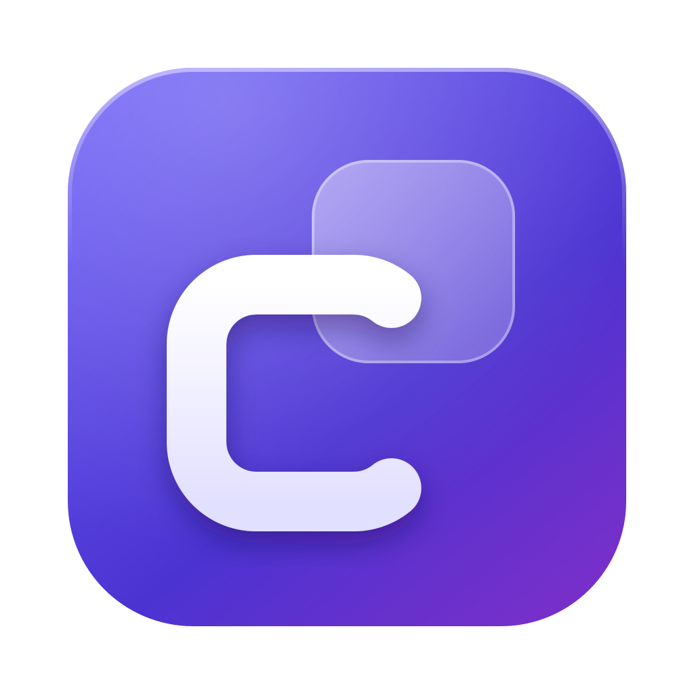
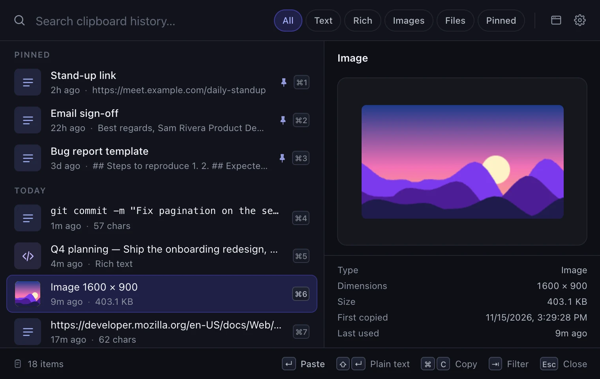
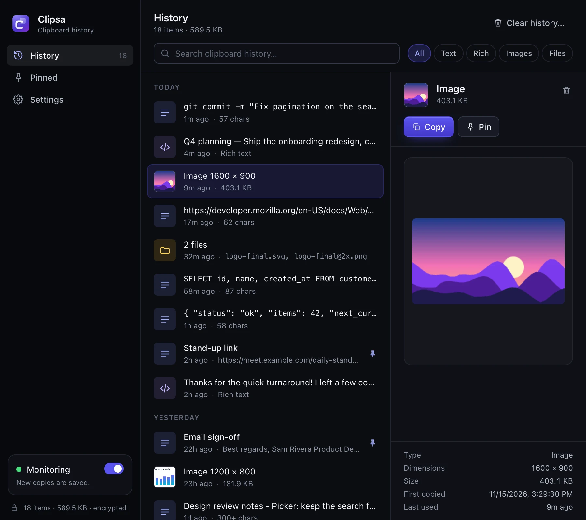
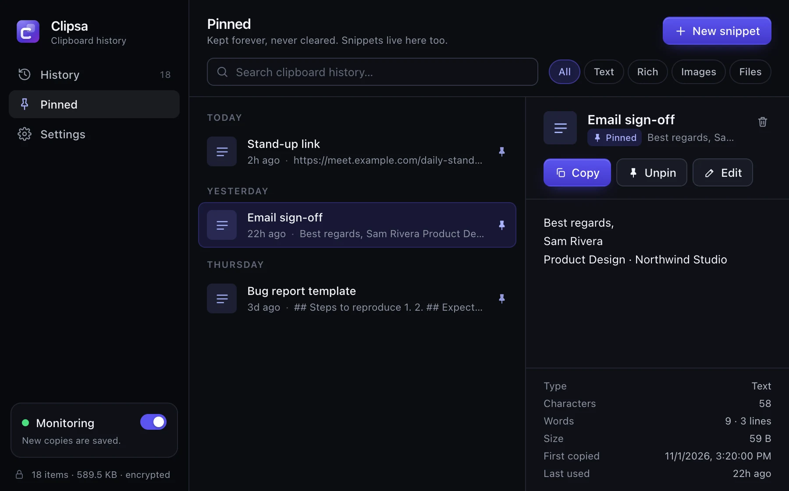
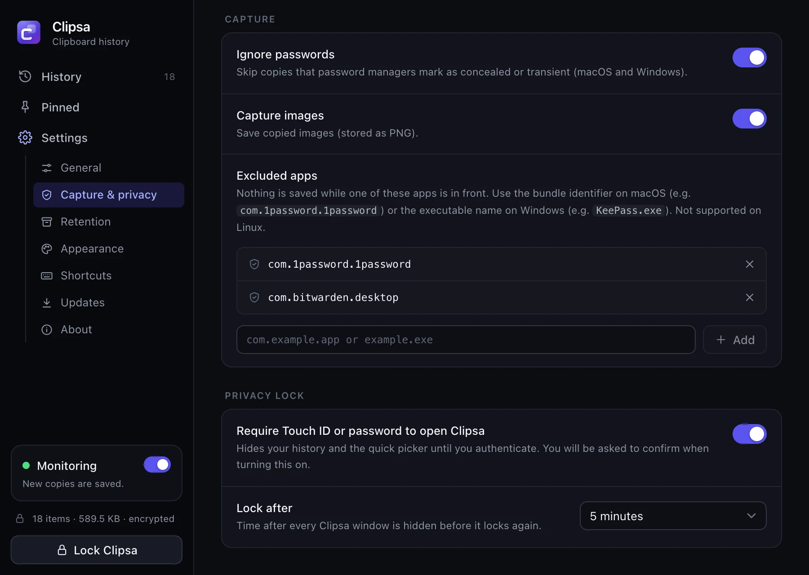
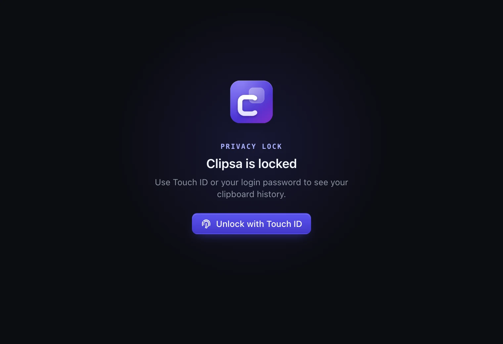

<div align="center">



# Clipsa

**The private clipboard manager for macOS, Windows and Linux.**<br>
Everything you copy, searchable and one keystroke away. Encrypted on your device, never sent anywhere.

[](https://github.com/mordamax/clipsa/releases/latest)
[](https://github.com/mordamax/clipsa/actions/workflows/ci.yml)
[](#install)
[](./LICENSE)
[](https://scorecard.dev/viewer/?uri=github.com/mordamax/clipsa)

[**Download**](https://clipsa.dev/#download) · [Website](https://clipsa.dev) · [Compare with Maccy, Paste, Raycast…](https://clipsa.dev/compare) · [Changelog](https://clipsa.dev/changelog)

<br>



<sub>The quick picker. Press <kbd>⌘</kbd> <kbd>⇧</kbd> <kbd>V</kbd> anywhere, type to filter, <kbd>Enter</kbd> to paste into the app you were using.</sub>

</div>

## Why Clipsa

- **Private by design.** Every item is encrypted on your device with AES-256-GCM, using a key kept in your system keychain. No account, no cloud, no telemetry. The only network request is an update check, and only if you turn it on.
- **Keyboard first.** One shortcut opens the picker, typing filters, <kbd>Enter</kbd> pastes straight into the app you came from, <kbd>⌘1</kbd>–<kbd>⌘9</kbd> pastes the first nine items.
- **Stays out of your secrets.** Copies that password managers mark as secret are never saved, and you can exclude whole apps.
- **Every format.** Text, rich text, images and copied files, put back on the clipboard exactly as they were copied.
- **Free and open source.** Every feature, no trial, MIT licensed.

## Install

| Platform | Download | Notes |
|---|---|---|
| **macOS** 10.13+, Apple Silicon and Intel | `.dmg` for [Apple Silicon](https://clipsa.dev/download/macos) or [Intel](https://clipsa.dev/download/macos-intel), or `brew install --cask mordamax/tap/clipsa` | Signed and notarized. Pasting into other apps needs the Accessibility permission ([details](#keyboard-shortcuts)). |
| **Windows** 10/11, x64 | [`-setup.exe`](https://clipsa.dev/download/windows) or [`.msi`](https://clipsa.dev/download/windows-msi) | Not code-signed yet, so SmartScreen may warn. |
| **Linux** x64 | [`.deb`](https://clipsa.dev/download/linux-deb), [`.rpm`](https://clipsa.dev/download/linux-rpm) or [`.AppImage`](https://clipsa.dev/download/linux-appimage) | Needs a Secret Service provider (GNOME Keyring, KWallet) to store the key. |

Every file comes from [GitHub Releases](https://github.com/mordamax/clipsa/releases); each release has a `SHA256SUMS` file to check downloads against. From the next release on, each installer also has a signed build provenance attestation: `gh attestation verify <file> -R mordamax/clipsa` checks that it was built by this repository's release workflow.

On first launch Clipsa asks whether it may check GitHub Releases for updates. Updates are verified against a signing key built into the app before they are installed.

## Features

<table>
<tr>
<td width="50%" valign="top">

### Full history, searchable

Text, rich text (HTML with its plain-text version), images (stored as PNG) and copied files, grouped by day. Search the text and titles, filter by type, and see each item in full with its details. Clicking an item copies it back in its original format.

</td>
<td width="50%" valign="top">



</td>
</tr>
<tr>
<td width="50%" valign="top">



</td>
<td width="50%" valign="top">

### Pins and snippets

Pin anything to keep it forever: pinned items are exempt from retention and "Clear history", can be renamed, and come first in the quick picker. Write reusable text snippets such as an email sign-off or a bug report template.

</td>
</tr>
<tr>
<td width="50%" valign="top">

### Capture what you want, skip what you don't

Copies marked concealed or transient by password managers are skipped (macOS and Windows), and you can exclude apps entirely. Limit history by item count and age, or pause monitoring from the tray.

</td>
<td width="50%" valign="top">



</td>
</tr>
<tr>
<td width="50%" valign="top">



</td>
<td width="50%" valign="top">

### Privacy lock

Require Touch ID or your login password (macOS) or Windows Hello to see your history after Clipsa has been in the background for a while. Capture keeps running while it's locked.

</td>
</tr>
</table>

Also: paste as plain text (<kbd>⇧</kbd> <kbd>Enter</kbd>, or by default), a menu bar / tray icon with pause, Settings and updates, launch at login, light/dark/system theme, a compact layout, and signed automatic updates that show the release notes first.

## Keyboard shortcuts

| Where | Key | Action |
|---|---|---|
| Anywhere | <kbd>⌘/Ctrl</kbd> <kbd>⇧</kbd> <kbd>V</kbd> (configurable) | Open the quick picker |
| Picker | type, <kbd>↑</kbd> <kbd>↓</kbd> | Filter, move the selection |
| Picker | <kbd>Enter</kbd> | Paste into the app you were using |
| Picker | <kbd>⇧</kbd> <kbd>Enter</kbd> | Paste the other way: plain text or with formatting |
| Picker | <kbd>⌘/Ctrl</kbd> <kbd>1</kbd> … <kbd>9</kbd> | Paste the 1st … 9th item (add <kbd>⇧</kbd> for the other format) |
| Picker | <kbd>⌘/Ctrl</kbd> <kbd>C</kbd> or click | Copy without pasting |
| Picker | <kbd>Tab</kbd> / <kbd>⇧</kbd> <kbd>Tab</kbd> | Next / previous type filter |
| Picker | <kbd>⌘/Ctrl</kbd> <kbd>O</kbd>, <kbd>⌘/Ctrl</kbd> <kbd>,</kbd> | Open the Clipsa window, Settings |
| Picker | <kbd>Esc</kbd> | Close |
| History window | <kbd>⌘/Ctrl</kbd> <kbd>F</kbd>, <kbd>↑</kbd> <kbd>↓</kbd> | Search, move through the list |

On macOS, pasting into another app needs the **Accessibility** permission (System Settings → Privacy & Security → Accessibility); Clipsa asks for it from Settings. Until it's granted, <kbd>Enter</kbd> copies the item, closes the picker and takes you back to your app, so you press <kbd>⌘</kbd> <kbd>V</kbd> yourself. The picker footer shows "Copy then ⌘V" while that's the case.

<details>
<summary><b>Platform support</b></summary>

| Capability | macOS | Windows | Linux |
|---|---|---|---|
| Text / rich text / images / files capture | ✅ | ✅ | ✅ |
| Change detection | NSPasteboard `changeCount` | `GetClipboardSequenceNumber` | Polling + content hash |
| Skip password-manager copies | ✅ (`org.nspasteboard.ConcealedType` / `TransientType` / `AutoGeneratedType`) | ✅ (`ExcludeClipboardContentFromMonitorProcessing`, `Clipboard Viewer Ignore`) | ❌ not available |
| Per-app exclusion | ✅ bundle id (e.g. `com.1password.1password`) | ✅ exe name (e.g. `KeePass.exe`) | ❌ not available |
| Paste into previous app | ✅ (needs Accessibility) | ✅ | ✅ on X11; Wayland compositors may block simulated keystrokes |
| Privacy lock | ✅ Touch ID / login password | ✅ Windows Hello (must be set up) | ❌ not available |
| Master key storage | Keychain | Credential Manager | Secret Service (GNOME Keyring, KWallet, …) |
| Release artifacts | `.dmg` / `.app` (Apple Silicon and Intel) | `.msi`, NSIS `.exe` | `.AppImage`, `.deb`, `.rpm` |

On Linux, Clipsa can't tell which app owns a copy and can't see password-manager markers. Use **Pause monitoring** in the tray before copying secrets, or delete the item afterwards.

</details>

<details>
<summary><b>Mac App Store edition</b> (coming)</summary>

A Mac App Store edition is coming, for people who prefer installing and updating through the App Store. It is the same app, with these differences required by the App Store sandbox:

- In the picker, <kbd>Enter</kbd> (and <kbd>⌘1</kbd>–<kbd>⌘9</kbd>) **copies** the item and closes the picker; press <kbd>⌘</kbd> <kbd>V</kbd> yourself. The sandbox doesn't allow sending keystrokes to other apps, so no Accessibility permission is involved.
- Updates come from the App Store; there is no built-in updater.
- Launch at login uses macOS Login Items. While it is on, Clipsa always starts in the menu bar.
- History lives in the app's sandbox container (`~/Library/Containers/com.clipsa.app/…`), separate from the direct-download edition, and is not migrated.

Build and submission: [docs/deployment.md](./docs/deployment.md#mac-app-store).

</details>

## Privacy and security

- Each item's content is encrypted with AES-256-GCM under a random 256-bit master key kept in the OS keychain. If keychain access fails, Clipsa refuses to start rather than create a new key and orphan your history.
- Duplicates are detected with a keyed HMAC-SHA256, so the database holds no plain hash of your content. Deleted rows are overwritten (`secure_delete`).
- **Not encrypted:** metadata such as content type, size, timestamps and the pinned flag, and settings.
- History is stored in `<data dir>/clipsa/clipboard.db` ([locations per OS](./docs/architecture.md#storage-layout)).

Clipsa protects your history at rest, for example a copied or backed-up database file. It is not a sandbox against malware running as your user, which can read the clipboard directly. The full model and its limits: [docs/security.md](./docs/security.md). Privacy policy: [clipsa.dev/privacy](https://clipsa.dev/privacy).

Please report vulnerabilities privately through [GitHub security advisories](https://github.com/mordamax/clipsa/security/advisories/new), not public issues.

## Development

Built with Rust, [Tauri 2](https://v2.tauri.app/) and SvelteKit. Install Rust stable, Node.js 22.17 or newer, pnpm 9 and the Tauri 2 system dependencies ([details](./docs/contributing.md#setup)), then:

```bash
pnpm install
pnpm tauri dev      # development build: separate data directory and key, no keychain prompts
pnpm tauri build    # installers in src-tauri/target/release/bundle/
pnpm install:mac    # macOS: build a release Clipsa.app, sign it and install it into /Applications
```

- Checks, tests, code guidelines and the pull request workflow: [docs/contributing.md](./docs/contributing.md)
- Local signing for `install:mac` and updater artifacts: [docs/deployment.md](./docs/deployment.md#local-builds)
- Release notes and releases: [docs/deployment.md](./docs/deployment.md#releases)

**Documentation:** [Architecture](./docs/architecture.md) · [Security model](./docs/security.md) · [Building and releasing](./docs/deployment.md) · [Contributing](./docs/contributing.md) · [Roadmap](./docs/development-roadmap.md)

## License

[MIT](./LICENSE)
