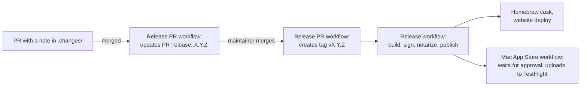

# Building and releasing

## Local builds

Install the prerequisites from [Contributing → Setup](./contributing.md#setup) first.

```bash
pnpm install
pnpm tauri build                 # installers in src-tauri/target/release/bundle/
pnpm tauri build --target aarch64-apple-darwin   # explicit target (rustup target add … first)
```

`bundle.targets` is `"all"`, so a build produces:

| OS | Artifacts |
|---|---|
| macOS | `.app`, `.dmg` |
| Windows | `.msi` (WiX), `-setup.exe` (NSIS) |
| Linux | `.AppImage`, `.deb`, `.rpm` |

### Installing into /Applications (macOS)

```bash
scripts/create-local-signing-identity.sh   # once: self-signed "Clipsa Local Signing" in your login keychain
pnpm install:mac                           # build, sign, install into /Applications and launch
```

The installed app is a release build: it uses the real data directory and the keychain-stored key. `install:mac` signs with `$CLIPSA_SIGNING_IDENTITY` if set, otherwise with the local identity when it exists, so macOS sees each rebuild as the same app and keychain "Always Allow" and Accessibility access are kept. Without either, the build is ad-hoc signed, and macOS asks for keychain access and Accessibility again after every install.

### Updater artifacts

Updater bundles and signatures are produced only when the release overlay `src-tauri/tauri.release.conf.json` is used. It sets `bundle.createUpdaterArtifacts: true`. The updater signing key must also be in the environment; `.env` files are not read.

```bash
export TAURI_SIGNING_PRIVATE_KEY="$(cat ~/.tauri/clipsa-updater.key)"   # path or contents
export TAURI_SIGNING_PRIVATE_KEY_PASSWORD=""                            # if set
pnpm tauri build --config src-tauri/tauri.release.conf.json
```

The public half of this key is `plugins.updater.pubkey` in `tauri.conf.json`. **Back up the private key.** If it is lost, existing installations can never auto-update again. Only generate a new pair (`pnpm tauri signer generate -w ~/.tauri/clipsa-updater.key`) if you accept that existing users must reinstall manually.

## CI (`.github/workflows/ci.yml`)

Runs on every pull request to `master` and on pushes to `master` on Ubuntu, macOS and Windows: `pnpm check`, `pnpm build` (`tauri::generate_context!` needs `build/` to exist), `cargo fmt --check`, `cargo clippy -D warnings` (plain, `--features self-update` and, on macOS, `--features app-store`) and `cargo test --all-targets --features self-update`. A **Site** job checks that the site pages generated from `CHANGELOG.md` are current and that the release notes in `.changes/` are valid (`scripts/check-changes.mjs`, which also lists them in the job summary). Tests use injected keys and never touch the OS keychain. All jobs are required checks for merging a PR; pushes to `master` that only touch `site/`, `docs/` or Markdown skip the app checks, since their PR already ran them.

## Releases

Releases are prepared by **covector** from release notes that pull requests add to `.changes/` (see [`.changes/README.md`](../.changes/README.md)), and published by GitHub Actions. The maintainer's only step is merging the release PR, plus approving the Mac App Store build.



The version has one source: `version` in `src-tauri/Cargo.toml` (`tauri.conf.json` and `package.json` have none, so Tauri uses Cargo's). Workflows read it with `scripts/app-version.sh`.

### Release PR (`.github/workflows/release-pr.yml`)

Runs on every push to `master`, in environment **`release-pr`** (`master` only), with a one-hour token of the Clipsa Homebrew GitHub App. GitHub doesn't start workflows for pull requests or tags created with `GITHUB_TOKEN`, so the App's token is what lets CI check the release PR and the tag start the release.

1. **release-pr**: if `.changes/` holds notes, it checks them (`scripts/check-changes.mjs`), runs `covector version` and force-pushes the result to the branch `release/next`, then opens or updates the PR **"release: X.Y.Z"** with the release notes as its description. `covector version` raises the version in `Cargo.toml` by the largest bump among the notes, adds a `## [X.Y.Z]` section to `CHANGELOG.md` with the notes grouped by section, deletes the note files and runs `scripts/finish-release.mjs`, which dates the section, rewrites each entry as `- Note ([#PR](link))`, runs `cargo update -p clipsa` and regenerates the site pages. The PR is rebuilt on every push to `master`, so it always contains everything merged so far, dated the day it was last rebuilt.
2. **tag**: if `master`'s version has no tag yet and `CHANGELOG.md` has its dated section, which only happens when a release PR was merged, it creates the tag `vX.Y.Z` on that commit. The tag starts the release workflow.

To release: review and merge the release PR. To change a note before that, edit it in `.changes/` through a normal PR; the release PR is rebuilt.

### Release workflow (`.github/workflows/release.yml`)

Triggered by the tag `vX.Y.Z`. It can also be re-run by hand (`workflow_dispatch`) on that tag: choose the tag under "Use workflow from". The tag must equal `v` + the app version; the **notes** job fails otherwise, so a mistyped tag can never add files to an already published release.

1. **notes**: extracts the `CHANGELOG.md` section for the version (see [Release notes](#release-notes)) and creates the **draft** release `v<version>` with it as the release text, once, before any build starts (a re-run of the whole workflow reuses that draft). The workflow stops here, before anything is built or uploaded, if the section is missing or empty, if the version is already published, or if more than one release exists for the tag.
2. **build** (matrix):
   - macOS arm64: `macos-latest`, `--target aarch64-apple-darwin`
   - macOS x64: `macos-latest`, `--target x86_64-apple-darwin`
   - Linux: `ubuntu-22.04`
   - Windows: `windows-latest`

   Each job runs `tauri-apps/tauri-action` (v1) with `--config src-tauri/tauri.release.conf.json` and uploads installers, updater bundles and `.sig` files into that draft (`releaseId`). The jobs don't touch `latest.json` (`uploadUpdaterJson: false`): when parallel jobs each looked for the draft or merged their entry into a shared `latest.json`, they raced (0.1.3 ended up with two drafts).

   On macOS, Tauri notarizes and staples the `.app` but only signs the DMG around it. The next step submits the DMG to Apple's notary service, staples the ticket and replaces the uploaded DMG, so `spctl -a -vvv -t install Clipsa_<version>_<arch>.dmg` reports `Notarized Developer ID`. The first notarizations for a new team can take an hour.
3. **publish**: runs only if every build succeeded. It attaches `SHA256SUMS` for the installers the website links to (`node scripts/build-site.mjs --assets`) and fails if any of them is missing, so a renamed bundle can't break a download page. It creates a signed build provenance attestation for those installers (`gh attestation verify <file> -R mordamax/clipsa`). It renders the Homebrew cask from `packaging/homebrew/clipsa.rb.in` with the DMG checksums from `SHA256SUMS` and attaches `clipsa.rb`. Then it generates `latest.json` once with `scripts/updater-manifest.sh` from the `.sig` files in the release: every platform is required, the `notes` field is the changelog section, and URLs are the regular `github.com/…/releases/download/<tag>/<file>` ones (not `api.github.com` asset URLs, which count against GitHub's anonymous limit of 60 requests per hour per IP). Then it makes the draft public (`gh release edit --draft=false --latest`). Releases are **immutable** once published (repository setting), which is why everything is attached before this point. From then on `https://github.com/mordamax/clipsa/releases/latest/download/latest.json` serves the new version to the in-app updater. Finally it starts the website deploy and the [Mac App Store workflow](#mac-app-store) for the tag, which waits for the maintainer's approval.
4. **homebrew**: gets a one-hour token from the Clipsa Homebrew GitHub App, limited to `mordamax/homebrew-tap` with `contents: write`, and pushes `clipsa.rb` there (`brew install --cask mordamax/tap/clipsa`).

If any build fails, the release stays a draft and no user receives the update. Fix the problem, delete the draft, then either re-run the failed jobs or, if the fix needs a new commit, release it as the next patch version: version tags can't be moved or deleted (ruleset "Immutable version tags"). To re-tag an unpublished version anyway, temporarily disable that ruleset under Settings → Rules.

### Release notes

`CHANGELOG.md` follows [Keep a Changelog](https://keepachangelog.com/en/1.1.0/) and is written by the release PR from the notes in `.changes/`; don't edit release sections by hand. Every version has a section headed `## [X.Y.Z] - YYYY-MM-DD` with entries under `### Added`, `### Changed`, `### Fixed`, `### Removed` or `### Security`. The file must start with `# Changelog` followed directly by the newest release: covector inserts each new release right after that heading, and the site would show any text there as part of it.

Everything between the version's heading and the next `## [` heading is published unchanged: as the GitHub release text, on clipsa.dev/changelog and in Clipsa's "Software Update" window (direct-download builds), which shows `latest.json`'s `notes` under "Release Notes". Notes are written for users, not developers (see `.changes/README.md`). The window renders a small Markdown subset: `##`/`###` headings, `- ` bullets, paragraphs, `**bold**` and `` `code` ``. Links are shown as their text only, and any HTML is displayed literally.

Notes flow: `.changes/*.md` → release PR → `CHANGELOG.md` → **notes** job → tauri-action `releaseBody` → GitHub release text and `latest.json` `notes` → updater plugin `Update.body` → update window.

### Releasing by hand

If the automation is unavailable, the same steps work locally: `pnpm exec covector version` (it runs `scripts/finish-release.mjs`), open a PR with the result and merge it; the **tag** job then tags it. Without the Release PR workflow, tag the merge commit yourself: `git pull && git tag vX.Y.Z && git push origin vX.Y.Z`.

Download counts come from GitHub Releases, which serve every download (website, direct links, Homebrew, in-app updates): `pnpm stats` prints them per version, split into macOS/Windows/Linux installers, macOS in-app updates and update checks (`latest.json` fetches). Neither the app nor the website tracks anything.

### Secrets

Release secrets live in the GitHub environment **`release`** (Settings → Environments), which accepts only jobs running from tags matching `v*.*.*`. No secret is stored at repository level, so workflows on branches and pull requests can't read them. See [Security → Release pipeline](./security.md#release-pipeline).

| Name (in `release`) | Kind | Needed for |
|---|---|---|
| `TAURI_SIGNING_PRIVATE_KEY` | secret | **Required.** Contents of `~/.tauri/clipsa-updater.key`. Without it, building with updater artifacts fails. |
| `TAURI_SIGNING_PRIVATE_KEY_PASSWORD` | secret | Only if the updater key is password-protected |
| `APPLE_CERTIFICATE` | secret | Required. Single-line base64 of the Developer ID Application `.p12` (`openssl base64 -A -in cert.p12`) |
| `APPLE_CERTIFICATE_PASSWORD` | secret | Required. Password of that `.p12` |
| `APPLE_SIGNING_IDENTITY` | secret | Optional, e.g. `Developer ID Application: Name (TEAMID)`; defaults to the identity in the certificate |
| `APPLE_API_KEY_ID`, `APPLE_API_ISSUER` | secret | Required. Notarization: App Store Connect API key ID and issuer ID. The key has the **Developer** role, which is enough for notarization and gives no access to the Apple ID's iCloud data. |
| `APPLE_API_PRIVATE_KEY` | secret | Required. Contents of that key's `AuthKey_<KEYID>.p8` |
| `HOMEBREW_APP_CLIENT_ID` | variable | Required for the **homebrew** job. Client ID of the Clipsa Homebrew GitHub App |
| `HOMEBREW_APP_PRIVATE_KEY` | secret | Required for the **homebrew** job. A private key (`.pem`) of that App |

`GITHUB_TOKEN` is provided automatically; the default is read-only and only the jobs that upload to the release get `contents: write`.

The **Release PR** workflow uses its own environment, **`release-pr`**, which accepts only `master` and holds nothing but the GitHub App's credentials: variable `HOMEBREW_APP_CLIENT_ID` and secret `HOMEBREW_APP_PRIVATE_KEY`, the same App as the **homebrew** job (the signing keys in `release` stay out of reach of `master`). Each job asks for a token limited to `mordamax/clipsa` and to what it needs: `contents: write` and `pull-requests: write` for the release PR, `contents: write` for the tag. The App therefore needs the repository permissions **Contents: Read and write** and **Pull requests: Read and write**, and must be installed on both `mordamax/homebrew-tap` and `mordamax/clipsa`.

macOS releases must be signed with a Developer ID and notarized; the workflow fails before building if any required Apple secret is missing. A stable signing identity is what lets users click "Always Allow" for keychain access and grant Accessibility once: macOS ties both to the code signature, so unsigned builds would re-prompt after every update. (The Tauri bundler treats an Apple variable set to an empty string as configured, so the workflow exports them only after this check.)

Windows installers are not code-signed; SmartScreen may warn until the app builds reputation.

## Website (Cloudflare Pages)

The static site in `site/` is served from the Cloudflare Pages project `clipsa` at clipsa.dev (DNS on Cloudflare; the domain is registered at Vercel with Cloudflare's nameservers). No framework, build or install step: the files are uploaded as they are. Pages serves `privacy.html` at `/privacy` (clean URLs). `site/_headers` sets the security headers (CSP without any third-party origin, `no-referrer`, `nosniff`) and caching for `/assets/`.

The release-dependent parts are generated from `CHANGELOG.md` by `scripts/build-site.mjs` (`pnpm site`) and committed: `site/changelog.html` (every dated release; an undated section is never published), the latest version and date wherever a page has `<!-- clipsa:version -->` / `<!-- clipsa:date -->` markers, and the download pages in `site/download/`. The pages load nothing at runtime, so the CSP and the privacy policy's "no scripts, no third-party requests" stay true. CI's **Site** job fails when the committed pages don't match `CHANGELOG.md`.

Download buttons never link to the GitHub release page, which also lists updater bundles, signatures, `latest.json` and the cask. Each installer has a page at `/download/<slug>` (`DOWNLOADS` in `scripts/build-site.mjs`, rendered from `scripts/download-page.html`): a meta refresh starts the download straight from `github.com/…/releases/download/v<version>/<file>`, so the site stays script-free and GitHub still counts every download (`pnpm stats`), and the page shows install steps and how to check the file against the release's `SHA256SUMS`. The pages link to versioned files, which is safe because the site is deployed only once that version is published (below). Adding or renaming an installer means editing `DOWNLOADS`; the release workflow then checksums the new list.

Deploys (`.github/workflows/site.yml`, environment `site` with the `CLOUDFLARE_API_TOKEN` secret and `CLOUDFLARE_ACCOUNT_ID` variable, `master` only):

- Every push to `master` that changes `site/` deploys, **unless** the version the pages announce isn't published on GitHub yet, or its release has no `SHA256SUMS` (which the download pages verify against; releases before 0.1.5 have none, so site changes wait for 0.1.5). A release PR therefore doesn't deploy; the release workflow's publish job starts the deploy once the downloads are live.
- By hand: Actions → **Deploy site** → Run workflow, or locally `pnpm exec wrangler pages deploy site --project-name=clipsa --branch=master` after `pnpm exec wrangler login`.
- wrangler is a pinned dev dependency, so CI installs it from the lockfile.

Previews: a pull request that changes `site/` gets a preview at `https://pr-<number>.clipsa-bhi.pages.dev` (`clipsa-bhi` is the Pages project's subdomain; previews are served with `X-Robots-Tag: noindex`), updated on every push. `scripts/site-preview-report.sh` reports it on the PR, like Vercel: one comment with the link, status and time, edited on every push instead of adding a new one, plus **Site preview** in the checks. `site-preview-build.yml` packs the PR's `site/` as an artifact without secrets; `site-preview.yml` (`workflow_run`, so it always runs master's version of the workflow and the script) deploys that artifact to the Pages branch `pr-<number>` with wrangler from master's lockfile, in environment `site-preview` (the same `CLOUDFLARE_API_TOKEN` secret and `CLOUDFLARE_ACCOUNT_ID` variable; deployment branches: `master` only). It refuses `_worker.js` and `_routes.json`, so a preview is static files only. PRs from forks get no preview, and previews skip the release gate above. Cloudflare keeps old preview deployments; delete them under Workers & Pages → clipsa → Deployments if needed. Changes to the preview workflows themselves take effect only once they are on `master`.

Traffic statistics come from Cloudflare's network (Analytics in the Cloudflare dashboard: requests, visitors, countries, bandwidth). Keep Cloudflare Web Analytics (the JavaScript beacon) off unless the privacy policy and CSP are updated with it; download counts come from GitHub (`pnpm stats`).

## Mac App Store

The App Store edition is built from the same code with the overlay `src-tauri/tauri.appstore.conf.json`. It sets `build.features: ["app-store"]`, which replaces the base `["self-update"]`, so the updater plugin is not compiled in. It also sets `bundle.category: "Utility"`, `minimumSystemVersion: "13.0"`, the sandbox entitlements, the provisioning profile and `src-tauri/appstore/Info.plist`, which is merged into the bundle's Info.plist. The upload workflow is `.github/workflows/appstore.yml`. It follows the [Tauri App Store guide](https://v2.tauri.app/distribute/app-store/).

### Edition differences

| | Direct download (GitHub / Homebrew) | Mac App Store |
|---|---|---|
| Cargo feature | `self-update` | `app-store` |
| Updates | Built-in updater (opt-in) | App Store |
| Picker `Enter` | Pastes into the previous app (needs Accessibility). Without it, copies, closes the picker and returns to the previous app for ⌘V; the footer then reads "↵ Copy then ⌘V" | Copies the item and hides the picker; the user presses ⌘V. The sandbox does not allow sending keystrokes to other apps. `paste_item` is compiled to a rejection, `check_permissions` reports Accessibility as `not_required` (the Accessibility UI is hidden), and the picker footer reads "↵ copy, then ⌘V to paste". |
| Launch at login | `auto-launch` entry with `--launched-at-login`: a LaunchAgent whose `AssociatedBundleIdentifiers` names `com.clipsa.app`, so macOS shows Clipsa (not the developer) in Login Items | `SMAppService.mainAppService` (ServiceManagement, macOS 13+). No LaunchAgent is written because the sandbox blocks it. If the user has to approve the login item, the setting fails with a message pointing to System Settings → General → Login Items. |
| Start in the tray | Only when started by the login item | A login item cannot pass arguments, so whenever launch at login is on (and registered with macOS) and the first-run screen is done, Clipsa starts in the menu bar. Opening it again (Finder, Dock, Spotlight) shows the window. |
| Data location | `~/Library/Application Support/clipsa` | `~/Library/Containers/com.clipsa.app/Data/Library/Application Support/clipsa`. Separate from the direct edition; history is not migrated. |

Everything else, including capture of text, rich text, images and file lists, encryption, the keychain key, app lock, exclusions and the global hotkey, is the same code.

### Entitlements

`src-tauri/appstore/Entitlements.plist.template` contains:

- `com.apple.security.app-sandbox`: required for the App Store.
- `com.apple.security.network.client`: required by WKWebView. Without it the sandboxed WebContent processes crash at launch and every window stays blank (reproducible with the smoke test below). Clipsa itself makes no network requests: the CSP only allows `ipc:`, and this edition has no updater.
- `com.apple.application-identifier` = `$(TEAM_ID).com.clipsa.app` and `com.apple.developer.team-identifier` = `$(TEAM_ID)`.

The workflow replaces `$(TEAM_ID)` with the `APPLE_TEAM_ID` secret and writes `src-tauri/appstore/Entitlements.plist`. It also decodes the provisioning profile to `src-tauri/appstore/embedded.provisionprofile`. Both files are gitignored. To build a store bundle by hand, create both files the same way (`sed "s/\$(TEAM_ID)/ABCDE12345/g" Entitlements.plist.template > Entitlements.plist`).

### Sandbox smoke test (local, unsigned)

A debug build uses a key file instead of the keychain, so you can run it in the sandbox without any certificates. Quit the installed Clipsa first; Clipsa runs as a single instance.

```bash
cat > /tmp/sandbox.entitlements <<'EOF'
<?xml version="1.0" encoding="UTF-8"?>
<!DOCTYPE plist PUBLIC "-//Apple//DTD PLIST 1.0//EN" "http://www.apple.com/DTDs/PropertyList-1.0.dtd">
<plist version="1.0"><dict>
  <key>com.apple.security.app-sandbox</key><true/>
  <key>com.apple.security.network.client</key><true/>
</dict></plist>
EOF
pnpm tauri build --debug --bundles app --config src-tauri/tauri.appstore.conf.json \
  --config '{"bundle":{"macOS":{"entitlements":"/tmp/sandbox.entitlements","files":{"embedded.provisionprofile":null}}}}'
codesign --force --deep --sign - --entitlements /tmp/sandbox.entitlements src-tauri/target/debug/bundle/macos/Clipsa.app
open -n src-tauri/target/debug/bundle/macos/Clipsa.app --stdout /tmp/clipsa.log
printf 'sandbox-test' | pbcopy
sqlite3 ~/Library/Containers/com.clipsa.app/Data/Library/Application\ Support/clipsa-dev/clipboard.db \
  'SELECT content_type, size, created_at FROM clipboard_items ORDER BY created_at_timestamp DESC LIMIT 5'
# When done: quit it and remove the test bundle so Launchpad/Spotlight don't
# list a second "Clipsa".
pkill -f "target/debug/bundle/macos/Clipsa.app" || true
/System/Library/Frameworks/CoreServices.framework/Frameworks/LaunchServices.framework/Support/lsregister -u src-tauri/target/debug/bundle/macos/Clipsa.app
rm -rf src-tauri/target/debug/bundle/macos/Clipsa.app
```

This checks that the app and its webviews start, data is written to the container, and text, image and file-list copies are captured. It does not cover the keychain (release builds only), `SMAppService` registration (needs a properly signed app), or the global hotkey and picker interaction.

### One-time setup

1. **App ID.** In [Certificates, Identifiers & Profiles → Identifiers](https://developer.apple.com/account/resources/identifiers/list), register an explicit App ID with Bundle ID `com.clipsa.app` (`tauri.conf.json > identifier`). The App ID Prefix is your team ID.
2. **App record.** In [App Store Connect](https://appstoreconnect.apple.com/apps), create a macOS app with that bundle ID.
3. **Certificates.** Create an **Apple Distribution** certificate and a **Mac Installer Distribution** certificate. Export each with its private key from Keychain Access as a `.p12`.
4. **Provisioning profile.** In Profiles, create a **Mac App Store Connect** profile (Distribution → Mac App Store Connect) for the App ID and the Apple Distribution certificate, then download the `.provisionprofile`.
5. **API key.** In App Store Connect → Users and Access → Integrations → App Store Connect API, create a team key with the **Developer** role, which is enough to upload builds (App Manager would also allow changing prices and submitting versions). Note the Key ID and Issuer ID, and download `AuthKey_<KEYID>.p8`. It can be downloaded only once.
6. Add the secrets below.

### Secrets

These live in the GitHub environment **`appstore`**, which accepts only runs from `master` and from version tags (`v*.*.*`) and **requires approval**: the job waits, without access to the secrets, until a required reviewer (the maintainer) clicks **Approve** on the run page. The workflow fails before building and lists any missing secret. They are separate from the Developer ID secrets in `release`.

| Secret | Value |
|---|---|
| `APPSTORE_CERTIFICATE` | base64 of the app distribution `.p12` (`openssl base64 -A -in dist.p12`): "Apple Distribution" or "3rd Party Mac Developer Application" (what Apple issues as *Mac App Distribution*) |
| `APPSTORE_CERTIFICATE_PASSWORD` | Password of that `.p12` |
| `APPSTORE_SIGNING_IDENTITY` | The certificate's common name, e.g. `3rd Party Mac Developer Application: Your Name (ABCDE12345)` |
| `APPSTORE_INSTALLER_CERTIFICATE` | base64 of the Mac Installer Distribution `.p12` |
| `APPSTORE_INSTALLER_CERTIFICATE_PASSWORD` | Password of that `.p12` |
| `APPSTORE_INSTALLER_IDENTITY` | e.g. `3rd Party Mac Developer Installer: Your Name (ABCDE12345)` (the certificate's common name) |
| `APPSTORE_PROVISIONING_PROFILE` | base64 of the `.provisionprofile` |
| `APPLE_TEAM_ID` | Team ID (fills the entitlements' application identifier) |
| `APPSTORE_API_KEY_ID` | App Store Connect API Key ID. Required only when uploading. |
| `APPSTORE_API_ISSUER_ID` | API Issuer ID. Required only when uploading. |
| `APPSTORE_API_PRIVATE_KEY` | Contents of `AuthKey_<KEYID>.p8`. Required only when uploading. |

### Running the workflow

The release workflow starts it for every published version tag, so each release gets an App Store build of exactly that tag; a tag that doesn't match the app version fails before anything is built. It can also be run by hand from `master` (test builds for TestFlight): Actions → **Mac App Store** → Run workflow. Either way the run waits for approval. It takes these inputs:

- `build_number`: `CFBundleVersion`. It must be unique for each version in App Store Connect. The default is the workflow run number.
- `upload`: when off, the workflow builds and signs but only attaches `Clipsa.pkg` to the run.

Steps:

1. Write the entitlements and the provisioning profile.
2. Import both certificates and Apple's WWDR intermediates into a temporary keychain, and check that both identities are valid there.
3. Run `pnpm tauri build --bundles app --target universal-apple-darwin --config src-tauri/tauri.appstore.conf.json`, signed with `APPLE_SIGNING_IDENTITY` from that keychain. `APPLE_CERTIFICATE` is not used: the Tauri bundler only recognizes some certificate names ("Apple Distribution:", "Developer ID Application:", …) when it imports one itself, and fails with "failed to resolve signing identity" for "3rd Party Mac Developer Application:". No notarization variables are set: App Store builds are not notarized.
4. Verify the signature, entitlements, profile, architectures and Info.plist.
5. Run `xcrun productbuild --sign "$APPLE_INSTALLER_IDENTITY" --component Clipsa.app /Applications Clipsa.pkg`.
6. Run `xcrun altool --upload-app --type macos --apiKey … --apiIssuer …`. The key is written to `~/.appstoreconnect/private_keys/AuthKey_<id>.p8` and removed afterwards.

After processing, the build appears under TestFlight in App Store Connect. The marketing version (`CFBundleShortVersionString`) is the app version from `src-tauri/Cargo.toml`. Submitting a version for review and releasing it happen in App Store Connect; the upload key's **Developer** role can't do either (that needs Account Holder, Admin or App Manager).

### Export compliance

**This is a legal declaration by the publisher.**

`src-tauri/appstore/Info.plist` sets `ITSAppUsesNonExemptEncryption` to `false`, so App Store Connect does not ask the encryption questions for every build. The reasoning:

- Clipsa encrypts only the user's own clipboard history at rest. It uses AES-256-GCM, HKDF-SHA256 and HMAC-SHA256 from the open-source RustCrypto crates (`aes-gcm`, `hkdf`, `hmac`, `sha2`), plus the macOS Keychain for the key. These are standard published algorithms, not proprietary cryptography. The App Store edition makes no network connections.
- Apple says to set the key to `NO` when the app "only uses forms of encryption that are exempt from export compliance documentation requirements" ([Complying with Encryption Export Regulations](https://developer.apple.com/documentation/security/complying-with-encryption-export-regulations), [ITSAppUsesNonExemptEncryption](https://developer.apple.com/documentation/bundleresources/information-property-list/itsappusesnonexemptencryption)).
- Apple's documentation table lists, for "an industry standard algorithm, not provided within the Apple operating system", only a **French encryption declaration**, and only when the app is distributed on the App Store **in France**. A CCATS is required only for proprietary or non-standard algorithms ([Export compliance documentation for encryption](https://developer.apple.com/help/app-store-connect/reference/app-information/export-compliance-documentation-for-encryption), [Overview of export compliance](https://developer.apple.com/help/app-store-connect/manage-app-information/overview-of-export-compliance)).
- On the US side, mass-market encryption items under EAR §740.17(b)(1) no longer need the annual self-classification report since the BIS rule of 29 March 2021 (86 FR 16482), and publicly available open-source encryption code using standard cryptography no longer needs the email notification ([Federal Register](https://www.govinfo.gov/content/pkg/FR-2021-03-29/pdf/2021-05481.pdf), [BIS: encryption items not subject to the EAR](https://www.bis.gov/learn-support/encryption-controls/encryption-items-not-subject-to-ear)).

Consequences:

- **France:** either exclude France from the app's availability, or file the French encryption declaration (ANSSI), upload it in App Store Connect → App Information → App Encryption Documentation, then set `ITSAppUsesNonExemptEncryption` to `true` and add the `ITSEncryptionExportComplianceCode` that Apple issues.
- If the encryption ever changes to a non-standard algorithm, or Clipsa starts sending encrypted data over the network (sync, for example), this decision has to be reviewed.
- Apple states that the developer carries the liability for a wrong exemption claim. This note is not legal advice.
